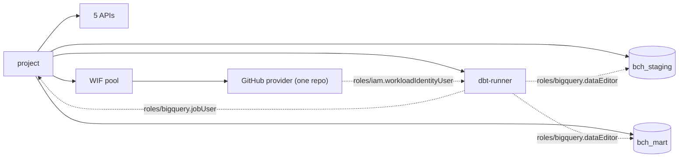

# bch-balances-terraform

Terraform for the infrastructure side of the Bitcoin Cash balances challenge. It creates one new GCP project with the APIs it needs, two BigQuery datasets (`bch_staging`, `bch_mart`), one service account for dbt (`dbt-runner`) with two predefined roles, and Workload Identity Federation (WIF) so the dbt repo's GitHub Actions can impersonate that service account without a key.

The dbt models and the CI workflow live in a separate repo: `carloshgalvan95/bch-balances-dbt`.

## What gets created

15 resources, all declared in this repo:

| File | Resources |
|---|---|
| `main.tf` | `google_project.main`; 5 x `google_project_service.apis` (bigquery, iam, iamcredentials, sts, cloudresourcemanager) |
| `bigquery.tf` | `google_bigquery_dataset.staging` (`bch_staging`), `google_bigquery_dataset.mart` (`bch_mart`), both in `US` |
| `iam.tf` | `google_service_account.dbt` (`dbt-runner`); `roles/bigquery.jobUser` on the project; `roles/bigquery.dataEditor` on each dataset |
| `wif.tf` | Pool `github`, OIDC provider `github-actions` restricted to one GitHub repo id, `roles/iam.workloadIdentityUser` on `dbt-runner` for that repo |

No GCP resource is created by hand. The only manual steps are the prerequisites below and copying the outputs into the dbt repo's GitHub Variables.

### Project structure

```
.
├── .gitattributes             # LF line endings for every text file
├── .gitignore                 # keeps state, plans, tfvars and key files out of git
├── .terraform.lock.hcl        # provider lock file
├── README.md
├── bigquery.tf                # datasets bch_staging and bch_mart
├── iam.tf                     # dbt-runner service account and its BigQuery roles
├── main.tf                    # project with delete guard, five APIs
├── outputs.tf                 # six outputs, one per dbt repo GitHub Variable
├── terraform.tfvars.example   # template for project_id, billing_account, github_repository_id
├── variables.tf               # five inputs; three validated; region and location defaults
├── versions.tf                # Terraform and provider pins; provider uses ADC
└── wif.tf                     # WIF pool, GitHub provider for one repo id, impersonation grant
```



Solid arrows: created in the project. Dotted arrows: IAM grants.

## Prerequisites

Set up before the first run (outside this repo's Terraform):

- A Google account that can create projects (no organization needed; soft-deleted projects count against your project quota for 30 days).
- Terraform CLI and `hashicorp/google` provider versions are pinned in `versions.tf`; `.terraform.lock.hcl` is committed.
- An open Cloud Billing account where you have at least Billing Account User (`roles/billing.user`). Tested with Billing Account Administrator (`roles/billing.admin`).
- The dbt GitHub repo must already exist, because WIF trusts it by numeric id.
- gcloud CLI with two logins: `gcloud auth login` for gcloud/bq, and Application Default Credentials (ADC) for Terraform (the provider sets no `credentials`; without `GOOGLE_CREDENTIALS` or `GOOGLE_OAUTH_ACCESS_TOKEN` it uses ADC):
  ```bash
  gcloud auth login
  gcloud auth application-default login
  gcloud auth application-default print-access-token > /dev/null && echo "ADC OK"
  ```
- Quota project: not needed in testing. On a 403 about it, set `USER_PROJECT_OVERRIDE=true` and `GOOGLE_BILLING_PROJECT=<another project you own>` (not the one this repo creates), where you have `serviceusage.services.use`; the APIs Terraform calls may need to be enabled there too.
- gh CLI, logged in with `gh auth login`, only to read the dbt repo id (or read it from the GitHub API by other means).

Built and applied step by step on Windows with Git Bash. Clean-room tested on 2026-10-21 in a clean WSL Ubuntu with tools installed from scratch, from a public clone, using the author's own Google and GitHub accounts and a new private copy of the dbt repo standing in for a fork. A different billing account, organization policies and real fork pull requests were not tested. Run every command from the repo root: Terraform writes `.terraform/` and `terraform.tfstate` in the current folder.

## Steps

1. Get the numeric id of the dbt repo:
   ```bash
   gh api repos/<owner>/bch-balances-dbt --jq .id
   ```
   Replace `<owner>` with the account that owns the dbt repo (your fork's owner if you rebuild from a fork). Expected: a number (the repo id). No code change is needed.

2. Create your variables file and fill it in:
   ```bash
   cp terraform.tfvars.example terraform.tfvars
   git check-ignore -v terraform.tfvars
   ```
   Set `project_id` (6 to 30 chars, globally unique, never reusable), `billing_account` (`gcloud billing accounts list`, format `XXXXXX-XXXXXX-XXXXXX`) and `github_repository_id` (digits only). `check-ignore` should print the matching `.gitignore` rule for `terraform.tfvars`. If it prints nothing, stop.

3. Initialize:
   ```bash
   terraform version
   terraform init
   ```
   Expected: the versions match `versions.tf` and `Terraform has been successfully initialized!`

4. Plan:
   ```bash
   terraform plan -out=tfplan
   ```
   Expected: `Plan: 15 to add, 0 to change, 0 to destroy.` (1 project + 5 APIs + 2 datasets + 4 IAM resources + 3 WIF resources) and 6 lines under `Changes to Outputs:`.

5. Apply:
   ```bash
   terraform apply tfplan
   rm tfplan
   ```
   Expected: `Apply complete! Resources: 15 added, 0 changed, 0 destroyed.` and the 6 outputs printed. `tfplan` holds variable values in plain form; it is gitignored and should be deleted.

   If a grant fails because the service account "does not exist", that is IAM eventual consistency: run `terraform plan -out=tfplan` and `terraform apply tfplan` again. Only the missing grants are created.

6. Plan again:
   ```bash
   terraform plan
   ```
   Expected: `No changes. Your infrastructure matches the configuration.`

## Verification

Replace `<project_id>` with your value.

```bash
terraform output
gcloud services list --enabled --project <project_id>
bq ls --project_id=<project_id>
bq show --format=prettyjson <project_id>:bch_staging | grep '"location"'
bq show --format=prettyjson <project_id>:bch_mart | grep '"location"'
gcloud projects get-iam-policy <project_id> --flatten="bindings[].members" --filter="bindings.members:serviceAccount:dbt-runner@<project_id>.iam.gserviceaccount.com" --format="table(bindings.role)"
gcloud iam workload-identity-pools providers describe github-actions --project=<project_id> --location=global --workload-identity-pool=github --format="value(attributeCondition)"
gcloud iam service-accounts get-iam-policy dbt-runner@<project_id>.iam.gserviceaccount.com --project=<project_id>
```

Expected:
- Enabled services: the 5 managed by this repo (`bigquery`, `iam`, `iamcredentials`, `sts`, `cloudresourcemanager`) plus some that Google enables on its own as dependencies. `compute.googleapis.com` is not enabled.
- `bq ls` lists `bch_staging` and `bch_mart` (ids only); each `bq show` prints `"location": "US"`.
- The project policy shows only `roles/bigquery.jobUser` for `dbt-runner`.
- Provider condition: `assertion.repository_id == '<your repo id>'`.
- One binding `roles/iam.workloadIdentityUser` for `principalSet://iam.googleapis.com/projects/<number>/locations/global/workloadIdentityPools/github/attribute.repository_id/<your repo id>`.

IAM changes can take a few minutes to propagate. The end-to-end test is the first dbt CI run.

## Outputs and GitHub Variables

Each output name is the lowercase name of a GitHub Variable in the dbt repo. Copy each value 1:1 (Settings, Secrets and variables, Actions, Variables). None of them is a secret.

| Output | dbt repo Variable | Value |
|---|---|---|
| `gcp_wif_provider` | `GCP_WIF_PROVIDER` | `projects/<number>/locations/global/workloadIdentityPools/github/providers/github-actions` |
| `gcp_sa_email` | `GCP_SA_EMAIL` | `dbt-runner@<project_id>.iam.gserviceaccount.com` |
| `dbt_gcp_project` | `DBT_GCP_PROJECT` | `<project_id>` |
| `dbt_staging_dataset` | `DBT_STAGING_DATASET` | `bch_staging` |
| `dbt_mart_dataset` | `DBT_MART_DATASET` | `bch_mart` |
| `dbt_location` | `DBT_LOCATION` | `US` |

## Design decisions

| Topic | Chosen | Discarded | Why |
|---|---|---|---|
| Service account roles | `bigquery.jobUser` on project, `bigquery.dataEditor` on the 2 datasets only | `bigquery.user` + `dataEditor` at project level | dbt only runs jobs and writes tables in 2 datasets. Widen to `bigquery.user` only if a real run fails on `bigquery.datasets.create`. |
| IAM resource type | `*_iam_member` (additive) | `*_iam_binding`, `*_iam_policy` (authoritative) | Never removes other members of the same role, such as the project owner or BigQuery default dataset access. (Dataset `_member` drops authorized-view entries; none here.) |
| CI auth | WIF, no key | JSON key in a GitHub Secret | No long-lived secret to store, leak or rotate. |
| WIF scope | Numeric `repository_id` in condition and principalSet | `owner/repo` name | A deleted repo name can be re-registered by someone else; an id is never reused. |
| Project id | Full variable `project_id`, set in tfvars | `random` provider suffix | One less provider; the id is visible before apply. |
| Dataset ids | `bch_staging`, `bch_mart` | `btc_*` | Source is `crypto_bitcoin_cash`; `btc` reads as Bitcoin. Matches repo names. |
| Location | `US` multi-region | EU | The source is in `US` and a standard query runs in one location. Cross-region global queries are Preview and need an opt-in on the source project, which we don't control. |
| State | Local, gitignored | GCS backend | One operator, no pipeline runs Terraform; a backend bucket is an extra resource with bootstrap steps. |
| GitHub Variables | Copied by hand from the outputs | Managed with the Terraform GitHub provider | Running Terraform needs no GitHub token with admin rights on the dbt repo; one less provider; six values set once. |

## Teardown

`deletion_policy = "PREVENT"` only blocks the project delete, which runs last, after everything that depends on the project is gone. **Do not test the guard with a plain `terraform destroy`: it removes up to 14 resources and leaves only the project, and re-applying then fails because the WIF pool and provider ids stay reserved about 30 days.** Datasets that hold tables also block the destroy. To remove everything:

1. In `main.tf`, set `deletion_policy = "DELETE"` on `google_project.main`.
2. In `bigquery.tf`, add `delete_contents_on_destroy = true` to both datasets (needed once dbt has written tables; the expected plan below assumes both).
3. `terraform apply`: the plan shows `0 to add, 3 to change, 0 to destroy` (in-place, `~`); after `yes`, expect `Apply complete! Resources: 0 added, 3 changed, 0 destroyed.`
4. `terraform destroy`. Expect `Plan: 0 to add, 0 to change, 15 to destroy.` and then `Destroy complete! Resources: 15 destroyed.`

Do not empty or delete datasets by hand with `bq rm`: teardown stays in code and state stays in sync.

After destroy the project stays soft-deleted for 30 days (restorable) and its id can never be reused.

## Limitations and next steps

- State is local. Next step for a team: a versioned GCS bucket in a separate bootstrap project, so destroying this project never deletes its own state.
- Data residency: the datasets are in `US` because the source is. For EU residency in production, replicate the source into an EU dataset and run dbt there. Documented, not built.
- Cost: creating these resources has no cost by itself. BigQuery storage and queries in this project are billed to its billing account; the free tier covers 10 GiB of storage and the first 1 TiB of on-demand query data processed per month, per billing account ([BigQuery pricing](https://cloud.google.com/bigquery/pricing)).
- No CI runs Terraform; it is applied by hand from one machine. Next step for a team: run `terraform fmt -check`, `terraform validate` and `terraform plan` on pull requests (not built here).
- The `dataEditor`-only setup assumes dbt never creates datasets. This holds while the dbt repo uses a custom `generate_schema_name` and `store_failures` stays off.
- WIF trusts every branch and workflow of the one dbt repo. Fork pull requests get read-only tokens and no OIDC token by default. The workflow must not use `pull_request_target`.
